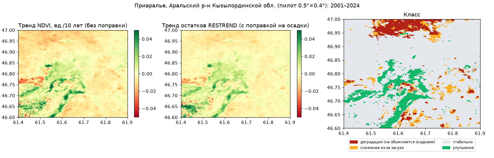

# 🌾 SteppeWatch-AI


## 📌 О проекте
**SteppeWatch-AI** — инструмент спутникового мониторинга деградации земель, опустынивания, засоления и степных пожаров в Казахстане: Приаралье, Мангистау, Бетпак-Дала, центральные степи.

Главная особенность — проект **отделяет деградацию от засухи**. Падение зелени в засушливый год — нормальная реакция степи, а не деградация. Проект показывает только те участки, где растительность ухудшается сильнее, чем объясняется осадками (RESTREND).

Проект рассчитывает индикатор **ЦУР 15.3.1** («доля деградированных земель») по методике UNCCD.

> **Статус: рабочий прототип.** Все методы реализованы и проверены на синтетической сцене с известной «правдой». Анализ реальных снимков работает двумя путями: через Google Earth Engine и через открытый стек (STAC, Planetary Computer) **без регистрации** — пример для Приаралья лежит в `results/`. Классификатору типов деградации нужна полевая разметка: пока он обучен на синтетике.

## 🧩 Что реализовано
| Задача | Метод | Модуль |
|---|---|---|
| **Отделение деградации от засухи** | RESTREND (регрессия NDVI на логарифм осадков текущего и прошлого года, тренд остатков), RUE | `steppewatch/trends.py` |
| Долгосрочный тренд | Манн–Кендалл с поправкой на связки, наклон Сена (векторизовано по пикселям) | `steppewatch/trends.py` |
| Точки перелома | Кусочно-линейная модель с одним переломом + F-тест Чоу (упрощённый BFAST, есть вариант с гармониками) | `steppewatch/breaks.py` |
| **Засоление** | SI, SI1, NDSI-salinity, SWIR-индекс, яркость → классы засоления | `steppewatch/indices.py` |
| Перевыпас | Модель пиосферы `NDVI(d) = a − b·exp(−d/L)` вокруг водопоев, радиус перегрузки | `steppewatch/piosphere.py` |
| **Классификация типа** | LightGBM, проверка на **отложенных районах** | `steppewatch/classify.py` |
| Степные пожары | NASA FIRMS (VIIRS/MODIS), кластеризация очагов; dNBR и классы тяжести | `steppewatch/fires.py`, `indices.py` |
| ЦУР 15.3.1 | LPD (trajectory/state/performance), матрица переходов покрова UNCCD, SOC, «один против всех» | `steppewatch/sdg.py` |
| Данные GEE | MOD13Q1 + CHIRPS, Sentinel-2 L2A, MCD64A1, WorldCover, SoilGrids | `steppewatch/gee.py` |
| Открытый стек | MOD13Q1 через STAC (Planetary Computer) + осадки ERA5 (Open-Meteo) | `steppewatch/opensource.py` |
| Дашборд | Streamlit: карты, ряды, ЦУР 15.3.1, переломы, пожары, выгрузка | `app/main.py` |

## 📊 Проверка на синтетической сцене (известная правда)
Сцена 30×30 км (MODIS 250 м), 2000–2024: перевыпас у двух колодцев, засоление, эрозия, пожар 2017 г., восстановление залежи и **аридизация** (осадки падают на 35 %).

| Процесс | Как классифицирован RESTREND |
|---|---|
| Аридизация (снижение NDVI из-за осадков) | **100 %** — «снижение из-за засухи», 0 % — «деградация» |
| Засоление | 100 % — «деградация» |
| Перевыпас | 90 % — «деградация» |
| Без изменений | 6 % ложных тревог (≈ уровень значимости 5 %) |

Классификатор типа деградации (проверка на отложенных районах): F1 — засоление 1.00, перевыпас 0.98, пожар 1.00, эрозия 0.83 ([`results/classifier_cv.json`](results/classifier_cv.json)).

Важно: простая динамика продуктивности (LPD по методике UNCCD) засчитывает аридизацию как деградацию (26 % площади против 23 % у RESTREND). Поэтому RESTREND показывается рядом с официальным индикатором.

## 🛰 Реальные данные: Приаралье (пилот)
Расчёт на **реальных данных** открытым стеком (без регистрации): MODIS MOD13Q1 2001–2024 (средний NDVI мая–августа, 96 месячных композитов через Planetary Computer) и осадки ERA5. Пилотный район 0.5°×0.4° у Аральска, ≈ 1 700 км²:

| Класс | Площадь | Доля |
|---|---|---|
| Деградация, не объясняемая осадками | 109 км² | 6.4 % |
| Снижение из-за засухи | 96 км² | 5.6 % |
| Стабильно | 1 342 км² | 79.1 % |
| Улучшение | 150 км² | 8.8 % |
| **ЦУР 15.3.1** (только субиндикатор продуктивности; покров и SOC — через GEE) | 199 км² | **12.0 %** |



Улучшение сосредоточено в понижениях и поймах вокруг Аральска. Это согласуется с восстановлением Малого Арала после плотины Кокарал (2005), но требует полевой проверки. Медианный R² связи NDVI с осадками здесь 0.41 (в открытом стеке используется один ряд осадков на район). Карты для дашборда: `results/kyzylorda.npz`, сводка: `results/kyzylorda.json`.

## 🚀 Быстрый старт
```bash
git clone https://github.com/Turubayev/SteppeWatch-AI.git
cd SteppeWatch-AI
python -m venv .venv && source .venv/bin/activate
pip install -r requirements.txt

# 1) Без регистрации: открытый стек (MODIS через STAC + осадки ERA5)
python scripts/restrend.py --aoi data/aoi/kyzylorda.geojson --start 2001 --end 2024 --source stac

# 2) Google Earth Engine (нужен Cloud-проект; осадки CHIRPS по пикселям, покров и SOC для ЦУР 15.3.1)
earthengine authenticate
export EE_PROJECT=my-cloud-project
python scripts/restrend.py --aoi data/aoi/kyzylorda.geojson --start 2000 --end 2025 --source gee
python scripts/salinity_burn.py --aoi data/aoi/kyzylorda.geojson --period 2024-05-01 2024-09-30

# 3) Пожары (бесплатный ключ FIRMS)
export FIRMS_MAP_KEY=...
python scripts/fires.py --aoi data/aoi/betpakdala.geojson --days 7

# 4) Классификатор типов деградации по полевым точкам
python scripts/train_classifier.py --labels data/field_points.csv

# Демо без интернета и дашборд
python scripts/restrend.py --source synthetic
streamlit run app/main.py
pytest -q
```
Пилотные районы: `data/aoi/` — Приаралье (`kyzylorda`), Устюрт (`mangystau`), Бетпак-Дала, центральные степи. Для своего района подойдёт любой GeoJSON-полигон.

## 🛰 Данные
| Источник | Что даёт | Доступ в проекте |
|---|---|---|
| MODIS MOD13Q1 (250 м) | Ряд NDVI с 2000 г. | GEE, STAC (Planetary Computer) |
| CHIRPS, ERA5 | Осадки | GEE (CHIRPS), Open-Meteo (ERA5) |
| Sentinel-2 L2A | SWIR для засоления, NBR для гарей | GEE |
| FIRMS (VIIRS / MODIS) | Активные очаги пожаров | API, ключ MAP_KEY |
| MCD64A1 | Гари | GEE |
| ESA WorldCover | Покров для ЦУР 15.3.1 | GEE |
| SoilGrids | Органический углерод почв | GEE |
| **Полевые данные** | Разметка типов деградации | CSV, см. `CONTRIBUTING.md` |

> **Где брать разметку для ML.** Геоботанические обследования пастбищ, данные научных институтов (почвоведение, ботаника), полевые выезды с партнёрами, экспертная разметка по снимкам высокого разрешения. Без этого шага классификация реальных районов не запускается; тренды и ЦУР 15.3.1 работают и без неё.

## ⚖️ Google Earth Engine: условия использования
* Некоммерческое и исследовательское использование бесплатно, но требует регистрации Cloud-проекта; коммерческое — платное.
* Ключевые расчёты (RESTREND, тренды, переломы, ЦУР по продуктивности) дублируются на открытом стеке (STAC + rasterio), общем с DalaFlood-Cast.

## 🚧 Ограничения
* MODIS 250 м не видит мелкие участки деградации; для них нужны Landsat и Sentinel-2.
* В пустынях с очень редкой растительностью NDVI малоинформативен.
* В открытом стеке осадки берутся одним рядом на район (ERA5): для больших районов используйте CHIRPS через GEE.
* «Деградация» на карте — сигнал для полевой проверки, а не доказательство нарушения землепользования.
* Матрица переходов покрова — значения UNCCD по умолчанию; её можно заменить национальной.

## 🗺 Roadmap
**Этап 1. Тренды**
- [x] Ряды NDVI (MODIS) и осадков (CHIRPS / ERA5) по пилотной области
- [x] RESTREND и Манн–Кендалл: карта деградации с поправкой на засуху
- [ ] Сравнение с Trends.Earth

**Этап 2. Засоление и пожары**
- [x] Индексы засоления
- [x] FIRMS и карты гарей (dNBR)
- [x] Отчёт ЦУР 15.3.1
- [ ] Калибровка порогов засоления по полевым пробам (EC)

**Этап 3. Классификация**
- [x] Классификатор с пространственной проверкой
- [ ] Сбор полевой разметки с партнёрами
- [x] Анализ перевыпаса вокруг водопоев (пиосфера)

**Этап 4. Пилот**
- [x] Дашборд (Streamlit)
- [x] Открытый стек (STAC)
- [ ] Пилот с акиматами и природоохранными организациями

## 🤝 Участие
Нужны: почвоведы, геоботаники, специалисты ДЗЗ, представители пастбищных хозяйств. См. [`CONTRIBUTING.md`](CONTRIBUTING.md).

## 📄 Лицензия
Код — **Apache 2.0**. Спутниковые данные используются на условиях лицензий их источников; Google Earth Engine — на условиях Google.
